# 架構與資料契約

唯一核心入口是 `python -m fall_detect`。CLI 子命令延遲載入所需模組；核心訓練／評估只讀骨架特徵快取，不匯入 AlphaPose backend。

```mermaid
flowchart LR
  A[RGB／影片＋timestamp] --> B[FrameRecord]
  B --> C[Tiny YOLO＋FastPose＋Tracker]
  C --> D[PoseRecord／pose cache]
  D --> E[CausalResampler＋WindowBuilder]
  E --> F[Human 13→14 點前處理]
  F --> G[凍結雙流 ST-GCN 512D]
  G --> H[FeatureRecord／feature cache]
  H --> I[Train ADL scaler＋AE]
  I --> J[Validation sequence 校準]
  J --> K[Frozen Scorer]
  H --> K
  K --> L[共用 EventState]
  L --> M[Test 指標／影片與 CSV]
```

| 模組 | 責任 |
| --- | --- |
| `config.py` | 嚴格欄位、比例、正整數、recipe shape 與相對專案路徑 |
| `contracts.py` | schema_version=1 的 Frame／Pose／Sample／Window／Feature 型別 |
| `assets.py` | 固定來源、safe ZIP extraction、hash 與失敗報告 |
| `data/` | 原始序列切分、numeric sort、frame-ID timestamp、版本化快取 |
| `pose/human.py` | 上游 Darknet／FastPose／Tracker 與明確 CPU/CUDA；RGB crop 還原原圖座標 |
| `skeleton/` | COCO17→13、肩中點、品質判定、過去觀測重採樣與固定端點 |
| `models/` | 嚴格 checkpoint、凍結雙流特徵、可訓練 MLP AE |
| `training/` | Train-only scaler、validation-normal early stopping、float64 門檻與 run 鎖定 |
| `detection/` | 每 track 最近 K 個分數的最小值、警示確認／結束與 sequence score |
| `evaluation/` | sequence 二元指標、unknown、固定分母、2×3 表 |
| `visualization/` | 由同一份結果產生圖表；逐幀串流影片／狀態／CSV |
| `pipeline.py` | 快取 prepare 和 demo 共用前處理／切窗／extractor 的資料契約 |

FrameRecord 包含原始 source_frame_id、零起算 sample_index、timestamp_ms、image_bgr、width、height；額外 source_missing 明確區分缺圖和純 metadata 物件。PoseRecord 使用原圖像素 `(x,y,confidence)`、`frame_size_wh=(width,height)`、每序列重設 track ID。新增肩中點不納入 13 個原始關節的品質計數。

主 recipe 為 `human_tsstg_coco_cut_v1`。原始窗 `[30,13,3]` → points `[1,3,30,14]`、motion `[1,2,29,14]` → features `[1,512]`。points 先 x/width、y/height，再各幀各軸 min/max 到 [-1,1]，再增加左右肩三欄平均；motion 只差分 x/y。有限的低信心座標保持不變；非有限或零／極小 span 不輸出正式特徵。輸入先複製，防止污染 pose cache。

FeatureRecord 同時保存 split、recipe、source window 起訖時間、available_at_ms、sample_index 和 row_index。無效預定端點仍有 metadata；row_index=null，NPZ 不存假分數。Cache 載入禁止 pickle，校驗 shape、finite、每筆對應、時序、split hash、recipe hash、source hash 和 NPZ SHA256。

缓存 key 包含全部來源圖片與同步檔的內容識別、pose／detector／ST-GCN 權重 hash、固定上游 commit、前處理版本、backend 設定、fps、窗長、stride、品質及時間 fallback。骨架／特徵分開，已完成序列可重用；單段中途失敗會重算該段。

AE 結構是 `D→128→32→128→D`，隱藏層 ReLU、輸出不加 sigmoid。Scaler 的 std=0 用 1。保存最佳正常 validation loss 的 state dict；patience 依 min_delta 判斷。校準成功前 Scorer 不能供正式 demo；校準後使用固定 artifact SHA256 驗證，evaluate 輸出新目錄。

上游 `.git` HEAD 與 tracked diff 會在載入時檢查；這次不修改上游 checkout。正式推論遇到權重、輸入或契約問題會停止／報 unknown，沒有以隨機初始化替代的路徑。測試中的 SyntheticExtractor 只存在 tests；synthetic 命令的手製特徵明確保存在 synthetic 目錄。

## 2026-09-17 替代 backend

新增 `backends.create_backends` 作prepare與demo共用的建構入口。`configs/openpose18.yaml`明確選擇LightweightPoseBackend與OpenPoseFeatureExtractor，其他設定仍選Human。recipe registry固定layout／關節数／feature_dim與上游commit；跨recipe的manifest、pose record、cache、AE或threshold不能混用。

替代流程：RGB/BGR影像 → Lightweight OpenPose的18點骨架及相鄰幀追蹤 → 因果30幀時間窗與缺失品質判定 → Kinetics相容中心化／confidence=0遮罩 → 原始ST-GCN的256維pooled features → train-only scaler → 256→128→32→128→256 AE → validation門檻 → 同track三窗警示。

新快取在data/cache/openpose18；完整原始split仍共用同一份70序列manifest，沒有因模型變更重切資料。原13點/512D路徑及測試保留。尾端缺失時間戳是否允許估計也纳入recipe fingerprint。
