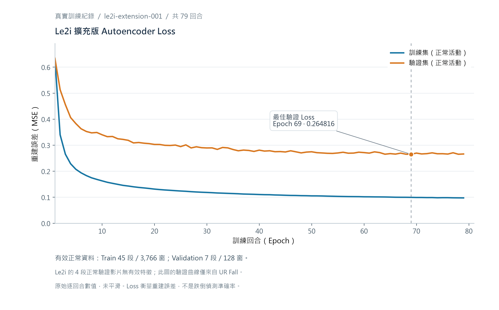

# Loss 圖與期末報告圖說

**要在程式畫面查看曲線，請雙擊根目錄「查看Loss曲線.cmd」。** 也可使用 `python -m fall_detect loss`；新訓練支援 `train --show-loss` 同步更新。詳見[程式內Loss操作](loss-viewer.md)。下方保留報告用圖片。

2026-09-17。這些圖由兩個已完成、凍結的真實run之training-history.csv直接產生；沒有新增訓練、平滑、補值或Test逐回合曲線。原模型、scaler、門檻與訓練CSV的hash已在匯出前後核對不變。

## 可以直接插入 Word／簡報的圖片

| 圖 | 高解析 PNG（300 dpi） | 向量 SVG |
| --- | --- | --- |
| Le2i擴充版，79回合 | [PNG](figures/loss/le2i-extension-001-loss.png) | [SVG](figures/loss/le2i-extension-001-loss.svg) |
| 原UR Fall基準，100回合 | [PNG](figures/loss/openpose18-baseline-001-loss.png) | [SVG](figures/loss/openpose18-baseline-001-loss.svg) |
| 兩次訓練並列 | [PNG](figures/loss/loss-side-by-side.png) | [SVG](figures/loss/loss-side-by-side.svg) |

單張為3180×1980，並列為4200×1860；繁體中文已實際渲染檢查。PNG適合直接貼進文件；SVG放大時不會因像素不足變模糊。



## 數值摘要

| 實驗 | 實跑回合 | 最佳Validation回合 | 最佳Validation MSE | 同回合Train MSE | 最後Train MSE |
| --- | ---: | ---: | ---: | ---: | ---: |
| openpose18-baseline-001 | 100 | 90 | 0.496766 | 0.060627 | 0.056615 |
| le2i-extension-001 | 79 | 69 | 0.264816 | 0.099280 | 0.097220 |

Le2i run在第79回合停止，保存的是第69回合最佳Validation模型。訓練實際採45段正常來源、3,766個有效特徵窗；正常Validation為7段UR Fall、128窗。Le2i的4段正常Validation全部無有效特徵，已直接寫在圖上。

## 可直接放進報告的圖說

**擴充版圖說：** 圖X為Le2i擴充實驗之Autoencoder訓練與驗證重建誤差。Autoencoder僅使用正常活動特徵訓練；橫軸為訓練回合，縱軸為標準化特徵的平均平方重建誤差（MSE）。訓練於第79回合結束，最低驗證Loss為第69回合的0.264816，並以該回合模型作後續校準與評估。曲線採實際逐回合紀錄，未作平滑。Le2i正常驗證影片皆未產生有效特徵，因此圖中驗證Loss僅來自UR Fall正常活動，不能視為完整的跨場景驗證。

**原基準圖說：** 圖Y為原UR Fall基準實驗之Autoencoder訓練與驗證重建誤差，共執行100回合，最低驗證Loss為第90回合的0.496766。Train僅使用正常活動，Validation使用正常活動選擇checkpoint。曲線顯示訓練誤差持續下降、驗證誤差在後期趨於平台；辨識品質仍須透過獨立的跌倒／正常測試與unknown比例評估。

**並列圖說：** 圖Z並列兩次實驗各自的收斂曲線。兩次實驗的訓練資料、特徵設定與Scaler不同，且縱軸分別縮放，因此不能將Loss數值的跨圖下降解讀為相同比例的跌倒辨識改善。效果比較應使用同一評估協定下的誤報、漏報與coverage。

## 怎麼解讀

藍線是Train正常特徵的重建MSE，橘線是Validation正常特徵的重建MSE；越低表示該模型較能重建該批正常特徵，並不是準確率。例如0.264816不能換算成73.52%準確率。

Train是每個minibatch更新模型時記錄的MSE，再按樣本數平均；Validation則是在每回合結束後，使用該回合固定模型計算。兩者計算時點不同，不能把同回合差值當成純粹的資料差異。曲線後段Train仍下降、Validation趨於平台，顯示泛化落差；單憑此圖不能區分過擬合、場景分布差異或骨架品質等原因。

Pose與ST-GCN在這兩次實驗中凍結，所以沒有本專案重新訓練它們的Loss。此圖是實際有訓練的AE Loss；不得把它標成Pose、ST-GCN或跌倒分類Cross-Entropy Loss。Test不參與逐回合選模，原流程沒有Test Loss history。

## 重現與證據

在專案根目錄使用既有.venv：

```powershell
.\.venv\Scripts\python.exe scripts/export_loss_figures.py
```

腳本讀取並檢查凍結run，將圖片寫到docs/figures/loss，不改動runs。可用`--runs`指定完成的real run、`--output`指定run外的目錄；目前需Microsoft JhengHei或Noto Sans CJK TC字型。

原始CSV的完全相同副本：[原基準CSV](figures/loss/openpose18-baseline-001-history.csv)、[擴充版CSV](figures/loss/le2i-extension-001-history.csv)。[數值與來源hash](figures/loss/loss-figure-summary.json)、[實際檢查結果](validation/loss-figures-checks.json)。繪圖陣列逐值核對CSV、最佳值核對status、PNG完整解碼、SVG結構解析、ruff通過，三張圖均已視覺檢查。此次只有繪圖腳本與文件，沒有重新執行完整模型訓練或Test評估。
