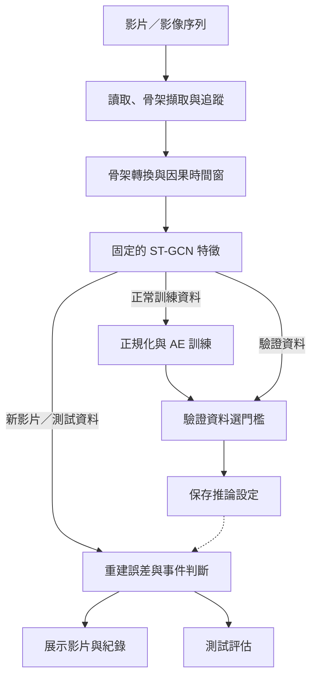

# 跌倒異常偵測專案：Codex 自動實作規格

版本：1.2｜原版日期：2026-09-11｜課程實作更新：2026-09-18｜專案名稱：`fall-detection-anomaly`

本文件可單獨交給 Codex。它包含實作指令、預設決策、資料與模型契約、開發順序及驗收條件，不需要讀取先前對話。目標是建立可執行、可重現、能展示與評估的 Python 專案。以下工程預設是本專案的選擇，不代表老師規定或官方 benchmark 協定。

## 0. 目前開發優先順序：期末課程對齊

2026-10-12接續授權階段：使用者要求繼續改善；前六SVM／兩AE候選已結束，不追加其網格。只研究一個新的正常近鄰側分支，保留wide的真實30幀isotropic ST-GCN及AE，原像素骨架另生30×3中心位移／log尺度軌跡，Train-only Scaler／5近鄰bank／整影片排除的Train定標，與wide分數按事前max規則融合。這是允許的正常資料One-class／時序表示實驗，不是教師要求或舊per_window重跑。原24Train ADL及23Validation、品質／K3保留，Test23未準備且拒絕讀取，單一候選校準完成即停止。辨識／展示採用分開、原demo不擅換、無Notebook／影片／上傳。[事前方法與驗收契約](docs/ur-motion-novelty-20261012-plan.md)。

本輪已完成（2026-10-12）：唯一20幀＋等比例候選39epochs／最佳29，Validation TP12／TN8／FP0／FN3／U0、Accuracy20/23／F1 .8889低於最高wide22/23／.9655，未採用、保留預設。完整47片Train／Val真實512D特徵重建、Test23片未準備；33風險測試、總273回歸通過／1歷史路徑skip、Train-only Scaler／23Val指標與每窗K3／14完整事件獨立核對及1,031舊檔保全完成。窗口coverage增加不當Accuracy改善；AI粗時段非人工GT，無本輪Test／RGB Pose／demo／real_end_to_end、Notebook／影片仍暫緩。[正式成果及限制](docs/ur-short20-isotropic-20261012.md)。

2026-10-12本輪契約：依使用者明確指示，只測一個 UR-only `20幀＋per_frame_isotropic` 候選，沿用最高 wide 的 AE256/64／seed42／max100／patience10及其餘訓練／Validation校準規則，原24 Train ADL不增強。允許顯式 `prepare/train --train-validation-only`：保持原70支split，完整準備47支Train／Validation，Test23支保留`not_prepared`且無pose／feature路徑；訓練須顯式opt-in、全部Train／Validation prepared，預設完整模式仍要求所有split，scoped run禁止Test evaluate。這是正式Train／Validation實驗的有界執行方式，不代表完整Test／real_end_to_end驗收。本輪不讀Test特徵、不混舊30幀Test cache、不追加候選。單一候選、pilot、採用與停止條件先鎖定，未全數通過就保留預設；粗時段不當人工時間GT，Notebook／影片繼續暫緩。[訓練前契約](docs/ur-short20-isotropic-20261012-plan.md)。

2026-10-12最新使用者修正：撤回外部正常訓練資料，raw／cache已移出原路徑並封存data/retired，舊混合run僅歷史比較。本條覆蓋下方歷史外部來源授權，後續Scaler／AE僅原UR Train24ADL及其Train限定增強；Val／Test角色及原70split保留。固定1%可靠關節位移由真實凍結ST-GCN重抽，原3,638＋增強3,638列，無新增原影片；單一AE29epochs的Val21/23／F1 .9286低於最高22/23／.9655，未採用。36風險測試、Train-only Scaler／23支K3與1,435舊檔hash保全通過，無新Test。UR-only指本專案AE資料，既有Pose／ST-GCN預訓練來源如實保留，不冒稱從零只接觸UR。資料增強不等於完整人工GT或課程效果達標。[本輪契約、成果與限制](docs/ur-only-shift-20261012.md)。

2026-10-12新增正常資料授權與完成範圍：外部32真實RGB中21符合原recipe／品質／窗口，可明示external_train-only加入原24UR Train ADL，所有來源／矩陣實際hash綁定sources與新run，Scaler／AE仍僅Train正常，原UR Val／Test及分母不變。13,270新RGB幀嚴格真實Pose／ST-GCN抽取，2固定AE共95epochs皆Val21/23／.9333，低於最高22/23／.9655，不採用。47Train／Val、340圖／15段跌倒AI取樣標註僅診斷，非完整人工GT，不用跌倒訓練AE、不重寫舊guard。36風險測試、1,160舊檔保全與46支次獨立K3通過；無新Test／七類方法替換，Notebook／影片暫停。來源腳本精確防護修復有封存hash，核心方法契約不變。[完整成果、限制及命令](docs/external-normal-20261012.md)。

2026-10-12最新Train限定增強與資料量診斷：明示鏡像原Train正常骨架、左右關節互換後經真實凍結ST-GCN，可作新run的Train-only衍生矩陣；不增加獨立原始影片數，不變更Validation／推論recipe，sources須綁定profile／實際矩陣hash。本次4子集曲線＋2鏡像AE實際312epochs，另2Train正常殘差profile新增epochs0，最高Val仍22/23／F1 .9655，未提高Accuracy。全部新候選未跑Test、原預設／guard保留，37風險測試及1110舊檔hash保全通過。註記改放sources的strict配置修復有舊source／lock封存，不重寫模型選擇；此增強實驗沿用本文件正常AE／真實權重／資料隔離契約。[完整結果與限制](docs/normal-data-support-20261012.md)。

2026-10-12後續明確Test授權：使用者要求固定大容量`ur-isotropic-wide-20261012-001`只跑一次原Test，不依結果調參。已完成：TP10／TN8／FP0／FN5／U0，兩種Accuracy18/23＝78.26%、Fall F1 .8000；原Validation門檻.5341113805770874、split、模型／Scaler及採用guard不變，未重訓／重切／校準／改選。13相關測試、獨立CSV／K3重算及1103舊檔hash驗證通過。這是另一次指定候選評估，補充前輪「不跑Test」範圍，不改其歷史實驗鎖定；Validation95.65%未延續到Test，不宣稱新盲測或警示時間合格。Notebook／五分鐘影片仍暫停。[正式結果與限制](docs/ur-isotropic-wide-test-20261012.md)。

2026-10-12最新準確率改善：依使用者禁止Test調參指示，先以Train／Validation診斷，再鎖定三組等比例Human特徵AE，實跑121epochs；wide的Validation TP14／TN8／FP0／FN1／U0，兩種Accuracy均22/23＝95.65%、Fall F1 .9655。新增TP可見警示guard未通過，原預設保留，不能稱警示時間正確。所有新候選未跑Test、舊Test82.61%／.8462保留；26相關測試及獨立CSV／K3驗收通過，1039舊檔hash不變。正式Notebook／五分鐘影片仍暫停，原方法及資料隔離契約不變。[本輪結果與限制](docs/isotropic-refinement-20261012.md)。

**最新Test授權與結果（2026-10-12）：** 使用者明確要求評估最高Validation候選，已對凍結`ur-human-isotropic-001`跑原Test，不更改舊採用guard／選模結論。Test TP11／TN8／FP0／FN4／U0，可判定與全體Accuracy19/23＝82.61%、F1 .8462；模型／Scaler／門檻／split不變。此新授權補充下方歷史「不追加Test」停止範圍，但沒有授權以Test再調參或重切來宣稱新盲測。17風險測試及獨立CSV重算通過，舊41run與92相關快取保留。[結果、驗證與限制](docs/ur-human-isotropic-test-20261012.md)。

**最新展示授權（2026-09-18）：** 使用者要求移除主畫面UNKNOWN，現將Human的auto改為sample：独立累積30次實際觀測，以原per_frame七類完整forward顯示動作，不受AE窗口品質遮罩；也支援isotropic AE，但不共用其不同前處理特徵。無人不偽造動作，小字追蹤／品質／新鮮度提示保留；AE unknown及成績不變。右欄另列真實K3事件歷史，不能視為目前Pose合格或反向修改舊選模guard。此條覆蓋下方歷史顯示預設與「ACTION必須UNKNOWN」的規則；核心AE方法不變。[完整契約及驗收](docs/sample-display.md)。

本次已完成232 tests passed／1歷史路徑skip，六片888幀AE分數／狀態／事件逐位元不變、674筆原分類頭full forward差0、H264解碼目視，41舊run／8764cache保存。這是展示驗收，不提高AE Accuracy、不保證七類正確，也不宣稱30FPS即時推論；正式Notebook／五分鐘影片仍暫停。

**最新已完成（2026-09-18，可見關節／比例）：** 新顯式`coordinate_normalization: per_frame_isotropic`保留像素寬高比；原模式／hash不變。AI目視關鍵影格診斷後，單一候選49epochs的Validation達21/23=91.30%、F1=.9286。fall-09可見AE警示5.9→5.0秒，但新補fall-30沒有可見警示，依事前guard保留原預設，新候選另存。新模式不套原七類頭；原30幀per_frame七類展示仍保留。完整215 passed／1歷史路徑skip，40舊run／8450cache保留，6片888幀核對。無新Test評分、正式Notebook／五分鐘影片，不宣稱課程已全部達標。[本輪方法與驗收](docs/human-isotropic.md)。

**最新準確度工作（2026-09-18，骨架／正常活動）：** 12片AlphaPose翻轉平均pilot未通過品質gate，未訓練該候選；Train-only KMeans8均衡影片內特徵型態的AE完成33epochs，Validation仍20/23、F1=.8889，保留原`ur-sample-human-s1-001`。新增選配`pose.flip_tta`預設false，舊recipe／推論不變；`autoencoder.sampling: sequence_patterns`僅影響Train正常資料抽樣，群組不是七類標籤。210 tests passed／1歷史路徑skip，四片723幀驗證一致，沒有新Test、正式Notebook／五分鐘影片。[規則、成績與驗收](docs/human-quality.md)。

**最新準確度優化（2026-09-18）：** 完成兩種Train正常殘差加權MSE對照，逐維19/23、雙分支20/23，沒有提高Accuracy；保留原`ur-sample-human-s1-001`（86.96%、F1=.8889）。新增`anomaly_score.mode`顯式候選，預設mse保持舊計算；新profile僅以Train ADL估計且綁定模型／Scaler／split／特徵hash，Validation重校準門檻。沿用凍結AE，新增epochs=0，不能冒稱重新訓練。203 tests passed／1歷史路徑skip，555幀真實推論一致，無新Test，正式Notebook／五分鐘影片繼續暫停。[本輪契約與驗收](docs/human-residual.md)。

**最新使用者授權：七類動作展示（2026-09-18，已完成）。** 可以接回原30幀Human七類分類頭作ACTION資訊，同時保留獨立ANOMALY (AE)欄。這補充下方「不直接顯示本流程未產生的七類名稱」歷史限制，現在必須由真實分類頭產生，不以規則或AE分數猜動作；不能以分類結果替換AE判斷或成績。骨架低品質／track gap／過期仍UNKNOWN，七類分數不是校準後機率。CLI預設auto，相符Human使用actions、其餘simple，既有API與顯式模式保留。503幀真實影片驗證AE CSV／事件逐位元相同，191 tests passed／1歷史路徑skip；無新訓練、Test或正式期末影片。[契約、驗收與操作](docs/seven-actions.md)。

**最新優化結果：** 短窗20／15幀與共用30幀座標尺度三候選共147epochs，Validation分別20/23、19/23、19/23，皆未提高Accuracy；保留原30幀`ur-sample-human-s1-001`（86.96%、F1=.8889），90%目標仍未達。新候選事件與可見畫面的品質遮罩差異已實測揭露；174 tests passed／1歷史路徑skip，無新Test，正式Notebook／五分鐘影片繼續暫停。[完整驗收與限制](docs/human-displacement.md)。

**保留但未採用的單一前處理候選：** `coordinate_normalization: per_window`共用30幀窗口的座標尺度；原`per_frame`預設與舊recipe hash保留。新候選不是上游原前處理重現，仍維持凍結ST-GCN512D＋Train正常AE、品質／K3與Test隔離。不得因其個案命中或較低Loss自動取代原模型。

**2026-09-18後續優化：** 依使用者持續優化授權，新增顯式Human短上下文20／15幀工程候選，補充第3節原30幀預設契約。原30幀行為、品質／K3、ST-GCN特徵＋正常AE與Test隔離不變；新時間變體有獨立recipe hash、cache與run，不宣稱重現上游30幀訓練分布。[有限實驗契約](docs/human-context.md)。

**最新持續優化（2026-09-18）：** 四組Human AE候選共170epochs全部仍Validation20/23=86.96%、F1=.8889，依事前平手規則保留`ur-sample-human-s1-001`。23項訓練隔離／校準／時序風險測試通過，無新Test或正式Notebook／影片；Accuracy90%仍未達。[候選、診斷與實際結果](docs/human-ae-refinement.md)。

**最新實測（2026-09-18，sample流程）：** 兩組Human雙流512D特徵＋正常AE共110epochs，選定`ur-sample-human-s1-001`，Validation20/23=86.96%、F1=.8889、unknown0；比舊17/23少3誤報，尚未達Accuracy90%。四個粗略時段命中0→2，但部分可見警示僅1–2幀，骨架與時機仍有限制。160 tests passed／1舊路徑skip，四片518幀／333窗分數一致；沒有新增Test或正式Notebook／期末影片。[完整驗收](docs/sample-human-reproduction.md)。

**2026-09-18最新指示：依sample流程實作。** 已重新取得同源Human鏡像权重，按第3.1節512D雙流特徵接正常AE；新增明確啟用的追蹤框裁切選項，新cache／run另列。覆蓋下方「本次不要求切回Human」的歷史優先順序，其他資料隔離／品質／Test限制不變。[實驗及結果](docs/sample-human-reproduction.md)。

**最新密集計分結果（2026-09-18）：** stride2／stride1維持30幀窗口與原品質，各訓練70epochs後Validation皆16/23=69.57%、F1=0.72，未超過舊17/23／0.80，未採用、未追加Test。fall-25個案警示時段改善不代表整體Accuracy改善；[實驗與驗收](docs/dense-schedule.md)。

**持續優化實測補充（2026-09-18）：** 兩組960骨架pilot未過gate；三組正常AE正則化／去噪共300epochs完成，Validation最高17/23=73.91%、F1=0.80。新增影片級TP實際在站立時警示、倒地後unknown，不能稱警示時機改善。未達目標、不追加Test或正式Notebook／影片；詳細候選、結果、驗證及限制見[AE泛化實驗](docs/ae-generalization.md)。

**展示更新補充：** 使用者2026-09-18要求簡短英文狀態，覆蓋先前「預設大字中文與分數面板」的呈現偏好。CLI預設`--overlay simple`，僅PENDING／NORMAL／FALL ALERT／UNKNOWN、骨架與更新提示；debug保留分數／ID，presentation保留舊中文。內部方法及unknown語意不變，不假裝能辨識STANDING／LYING。只另存示範短片，正式Notebook與五分鐘影片仍等待辨識改善。見[展示契約與驗收](docs/simple-demo.md)。

**2026-09-18最新指示：先達辨識目標，再更新Notebook與期末影片。** 下列CA交付是歷史成果，不代表已達課程基準。新的[Accuracy優先工作紀錄](docs/accuracy-first-plan.md)優先適用；固定split、Test隔離及unknown分母不變。旋轉骨架pilot未通過事前門檻，停止該候選，不能把功能測試或特徵窗增加說成Accuracy改善。簡報第45張所引論文的協定已有補查，不把論文設定直接當成教師強制規則。

已依 [期末專案調整計畫](docs/course-alignment-plan.md) 完成本機 CA-01 至 CA-05：UR Fall Train/Validation 診斷、UR-only 三候選、已執行Notebook、中文展示與五分鐘有聲／無聲影片。選定course-ur-balanced-001，Test全體11/23、可判定Accuracy50%／F1 56%，辨識品質仍不足。[實際成果與驗收](docs/course-results.md)。Le2i／CAUCAFall 與混合模型保留為擴充比較，不能用其成績代替 UR Fall／UP-FALL 的課程成果。

已確認教師基準為 UR Fall Accuracy 90.00%／F1 0.87，UP-FALL Accuracy 98.52%／F1 0.93；課程指定選一資料集、以 Accuracy 和 F1 評分，並要求五分鐘 YouTube 影片及課堂 demo。詳細切分、評估單位、unknown 計分、額外訓練資料與公式仍待釐清，見調整計畫的來源表。這些基準不是本專案已達到的成績。

目前已完成的混合基準為 `caucafall-yolo11-balanced-001`：YOLO11m Pose → OpenPose18 → 凍結 Kinetics ST-GCN 256D → 正常資料 Scaler／AE。以下第 3 節的 Human 512D 是原始路徑契約，保留作歷史及該 backend 的實作依據；本次不要求切回缺資源的 Human。未來換 recipe 仍須依原契約重建與驗證。

課程對齊不改變第10節指標與unknown公式、正常訓練、資料隔離、真實權重、時間因果性及事件規則。現有Test已多次被查看，結果須揭露工程對照性質，不因另建run或重切split宣稱恢復獨立性。第9.3節保留原始F1校準預設；mixed及本輪UR-only的balanced sequence accuracy校準依各自凍結設定解讀，UR候選規則已記於訓練前鎖定紀錄。

2026-09-18 的本輪候選與Test評估已完成，停止條件已達，不自動追加調參。CLI demo預設中文presentation，可用--overlay debug保留原顯示；推論／事件／品質規則不變。公開上傳及教師尚未明定事項仍待使用者／教師處理，各階段實測證據見驗收文件。

## 2026-10-12 最新方法研究契約（優先於歷史工程預設）

本節依使用者明確授權調整方法範圍；下文既有設定與所有歷史 lock／成果保留，不回溯改寫。修改前文件逐位元封存於 `docs/validation/ur-normal-methods-20261012-001/prior-contract`。

| 層級 | 本輪契約 |
| --- | --- |
| 教師方向 | 跌倒作為異常偵測、正常資料學習；附件簡報第37–40頁列 One-class classification／Autoencoder 與 ST-GCN 特徵示例。UR Accuracy90%／F1 .87為參考，不自行換算課程分數。 |
| 使用者要求 | 保留AE基準，擴大One-class／替代AE／時序表示比較；有診斷依據才可另立最多一個正常Train自監督微調，不用Fall或七類分類Loss。僅原24UR Train ADL，外部資料封存，不新增Test。 |
| 歷史工程預設 | 凍結ST-GCN、30幀、MLP AE、K3是原實驗選擇，對該凍結版本仍有效；不是教師永久強制或新研究禁令。 |
| 本輪第一階段選擇 | 固定原30幀isotropic真實512D特徵、Train-only scaler、原品質與K3；RBF One-Class SVM最多六組nu=.01/.05/.10 × gamma=scale/.001，負decision_function越大越異常，各自Validation門檻。 |
| 第二階段選擇 | 依SVM與診斷另鎖最多兩個AE（去噪、保留時間順序），seed42／最多100epochs／patience10，僅正常Validation選checkpoint；同影片同track連續合法窗口、缺失重置、無未來補值。 |
| 採用與比較 | 新候選與各自門檻以含unknown整体Accuracy、Fall F1、全體Fall Recall、較少FP、固定候選順序依序排序。較基準更佳才列辨識採用候選；展示可見警示guard另列，研究採用不自動切换demo。 |

Scaler／學習式前處理只在Train擬合；Validation與Test或其增強副本不得作訓練。模型／門檻／事件規則只由Train／Validation決定。不看歷史Test成績調參，不重切恢復盲測。預訓練嚴格真實權重；七類分類僅獨立診斷，不能取代異常模型。

Sample PDF第3–4頁主張AE流程，第6頁報70支影片成績；附件沒有完整可重現AE訓練及評估證據，因此不得斷言其全部成績來自七類分類器。影片级判對、粗時段事件、當前良好骨架可見警示分開；AI時段不是人工時間真值。新方法Test未知，synthetic／real_feature_smoke／real_end_to_end分開。正式Notebook／五分鐘影片繼續暫緩，舊成品保留、不上傳。

## 1. 給 Codex 的工作指令

請直接依本文件建立並實作專案，包含程式、設定、文件、必要測試及在目前環境可執行的驗證。不要只回覆計畫、建立空目錄或留下大量 TODO。

執行原則：

1. 先讀目前工作區適用的 `AGENTS.md` 與已有專案內容。若是空工作區，在其中建立本專案；若已有其他專案，建立 `fall-detection-anomaly/` 子目錄，保留原有內容。若已存在本專案，接續進度，避免重建覆蓋。
2. 先偵測作業系統、Python、CPU/GPU、可用磁碟與依賴狀態。使用專案虛擬環境，不修改系統 Python。所有動作仍遵守執行環境與使用者既有權限。
3. 依本文預設自行處理一般工程選擇，不需先詢問顯卡、資料夾名稱、編輯器或配色。不能自動判定的設定，採有記錄的預設值或標示真正的外部阻塞。
4. 先完成一個小型真實輸入的整合檢查，再進行完整資料處理。模型與資料取得失敗時，完成其他不依賴該資源的程式、資料契約、測試與操作說明。
5. 不得繞過網路或權限限制；不得為了讓指令成功而關閉驗證、假造權重、使用隨機特徵代替真實 ST-GCN，或把測試集拿來選模型與門檻。
6. 若存在可獨立並行的資料、模型與展示工作，可分工；先固定共用契約，避免不同模組各自定義骨架格式。
7. 持續實作至本環境可達成的驗收項目完成。每一階段更新 `docs/current-progress.md`，記錄已完成、未完成、實際指令、結果、阻塞原因及下一步。
8. 最後用繁體中文交代：完成內容、實際執行過的驗證、尚未執行的項目，以及使用者下一個可直接執行的命令。不得把「程式已完成」等同「真實資料已驗證」。

### 使用者可直接貼給 Codex 的啟動指令

> 請完整讀取 `Fall_Detection_Codex_Implementation_Spec.md`，依規格直接建立並實作專案。先檢查環境與模型來源，再按里程碑逐步完成。一般選項使用文件預設，不要只提供計畫。請實際執行可執行的測試與小型整合驗證，持續更新進度文件。遇到權重、資料或環境阻塞，完成其餘工作並明確記錄，禁止以模擬結果宣稱真實跌倒偵測成功。

## 2. 目標、範圍與方法界線

### 2.1 第一版必須完成

- 輸入 UR Fall camera 0 的 RGB 影像序列，並支援一般影片檔。
- 偵測人物、擷取骨架、維持人物身分、形成固定長度的骨架時間窗。
- 使用固定的預訓練 ST-GCN 動作特徵，不在第一版重新訓練骨架模型或 ST-GCN。
- 使用 **UR Fall 正常訓練序列**訓練 Autoencoder（AE）。
- 使用驗證資料選擇異常門檻；固定設定後在測試資料計算指標。
- 輸出含骨架、異常分數、正常／疑似跌倒／無法判定狀態的展示影片與紀錄。
- 保存資料切分、模型版本、前處理、正規化、門檻與實驗結果，讓同一版本可重跑。
- 支援 CPU 執行與可用時使用 CUDA；CPU 不承諾即時速度。

第一版以離線影片為主要展示方式。Web UI、帳號、資料庫、雲端服務、LINE 通知、多鏡頭、手機 App 及部署不列入必要範圍。攝影機輸入可在離線流程完成後擴充。

### 2.2 必須正確陳述的方法

主路徑的 Human-Falling-Detect-Tracks 動作權重，以 Le2i 的人工動作標註訓練，類別包含跌倒。因此本專案可以陳述：

> 使用預訓練骨架動作表示；Autoencoder 僅以 UR Fall 的正常訓練資料學習，再以重建誤差進行異常判斷。

不得陳述「整套模型從未看過跌倒」、「全流程無監督」或「直接重現老師論文成績」。若課程另要求所有前置模型都不能接觸跌倒資料，必須重新檢視預訓練來源與實驗協定；不能只換一個 checkpoint 名稱就宣稱符合。

高重建誤差表示偏離已學正常特徵，並不保證一定跌倒。系統對使用者的提示用「疑似跌倒」。

## 3. 參考資源與明確的整合選擇

| 資源 | 本專案用途 | 不應誤解為 |
| --- | --- | --- |
| [Human-Falling-Detect-Tracks](https://github.com/GajuuzZ/Human-Falling-Detect-Tracks) | 主路徑：借用人物偵測、AlphaPose、追蹤、雙流 ST-GCN 與展示相關實作 | 跑原始七類分類 demo 就已完成 AE 異常偵測 |
| [原始 ST-GCN](https://github.com/yysijie/st-gcn) | 理解模型、必要時採原始 OpenPose18 相容路徑 | 必須額外串在 Human 動作模型後面 |
| [KingMV/st-gcn_ad](https://github.com/KingMV/st-gcn_ad) | 額外研究參考；第一版不是執行依賴 | 現成、完整且直接符合本文件的 AE 系統 |
| [UR Fall](https://fenix.ur.edu.pl/~mkepski/ds/uf.html) | 正常與跌倒影像、時間資訊及相關標註 | 模型、程式套件或執行新影片時的必要資料庫 |

### 3.1 主路徑：Human 原配雙流模型

先驗證以下組合，避免任意混搭不同來源的骨架與權重：

`人物偵測 → Human 的 AlphaPose 輸出 → Human 骨架前處理 → TwoStreamSpatialTemporalGraph → 512D 特徵 → AE`

- Human 的 AlphaPose 載入程式使用去除眼睛、耳朵四個點的 COCO 骨架，共 13 個點。
- 動作模型前處理再加入左右肩中點，形成 14 個點。
- 位置流（points stream）輸出 256D；運動流（motion stream）輸出 256D；串接後為 **512D**。
- 原模型接 `Linear(512, 7)` 作七類分類。AE 必須接分類頭之前的 512D，不能接七類機率。
- 先建立完整原模型並嚴格載入相符的 checkpoint，再提供 `extract_features()`，取兩個 stream 的 pooled 特徵串接。不要先移除分類頭再以 `strict=False` 吞掉權重錯誤。
- 第一版不以七類分類結果直接代替 AE 判斷；原分類頭可保留作相容性檢查。

### 3.2 替代路徑與切換條件

如果主路徑的權重或依賴無法取得：

1. 先修復可定位的裝置、API 或載入問題，保留原運算語意。
2. 次選為原始 ST-GCN 的 **OpenPose18** 路徑，但必須取得相符權重、骨架輸入及前處理；其 pooled 特徵通常為 256D，仍須由程式驗證。
3. 換姿態估計器、轉換關節或修改前處理皆視為新的 backend recipe，記錄點位映射、正規化與分布差異，重建特徵與 AE；不能沿用舊 AE 與門檻。
4. 不得把 14 點雙流權重直接載入 18 點原始 ST-GCN，也不得把不同特徵維度補零湊成 512。
5. 如果沒有一組真實可用的骨架＋ST-GCN 組合，明確標示端到端驗證受阻，完成其餘程式。不得自動把目標改為七類分類或其他模型後宣稱原規格完成。

次選 recipe 若確實啟用，契約為原始 Kinetics400 的 `st_gcn.kinetics.pt` checkpoint、`in_channels=3`、`num_class=400`、`edge_importance_weighting=True`、`layout=openpose`、`strategy=spatial`、18 個關節、輸入 `[N,3,T,18,M]`。每個真實 track 分別處理，`M=1`，不加假人平均。採固定 commit 的 Kinetics feeder 座標正規化與 confidence=0 遮罩，不能套用 Human 的 per-frame min/max。`extract_feature()` 第二項的 feature map 為 `[N,256,T',18,M]`，在時間、關節及有效人物維度池化成 `[N,256]`；不能取第一項的 400 類輸出。原 feeder 使用 300 個時間位置，本專案短窗屬設計變更，所選 T／fps 必須記錄並用 validation 確認。

次選 pose backend 必須提供完整 OpenPose18，或有完整且已驗證的 COCO17→OpenPose18 映射；Human 已裁掉眼耳的 13 點不能憑空補成相容輸入。主路徑未阻塞時不需為了備援而實作第二整套模型。

文件整理時已核對上述模型程式的結構；尚未下載所有權重、建立相容環境或完成真實推論。Codex 必須自行完成這些驗證，不能把本文當成權重可用性的證明。

## 4. 系統與程式架構



資料先完成原始序列切分，才進行時間窗與特徵處理。訓練與推論共用前處理程式，避免各寫一份導致輸入不一致。

### 4.1 建議目錄與責任

採 `src` package layout，Python package 名稱為 `fall_detect`。以下皆為專案根目錄下的相對路徑。

| 路徑 | 責任 |
| --- | --- |
| `README.md` | 繁體中文安裝、資料準備、訓練、展示、排錯與限制 |
| `AGENTS.md` | 本專案後續維護規則、必要驗收與進度更新方式；遵守既有上層規則 |
| `pyproject.toml` | 套件設定、CLI 入口與依賴分組 |
| `requirements/` | 驗證後的 core／pose backend／CPU 或 CUDA 環境版本紀錄 |
| `configs/default.yaml` | 所有可調設定及預設值 |
| `src/fall_detect/__main__.py` | `python -m fall_detect` 入口 |
| `src/fall_detect/cli.py` | 子命令、參數驗證及結束碼 |
| `src/fall_detect/config.py`、`contracts.py` | 設定與跨模組資料型別 |
| `src/fall_detect/data/` | UR Fall 匯入、影片讀取、標註、split manifest |
| `src/fall_detect/pose/` | 人物偵測、姿態模型、人物追蹤及 backend adapter |
| `src/fall_detect/skeleton/` | 點位、正規化、品質檢查、時間重採樣及切窗 |
| `src/fall_detect/models/` | ST-GCN adapter、Autoencoder、權重驗證 |
| `src/fall_detect/training/` | 特徵 scaler、AE 訓練、checkpoint、驗證門檻 |
| `src/fall_detect/detection/` | 分數、連續觸發、unknown 狀態與事件輸出 |
| `src/fall_detect/evaluation/` | 本文件明訂的序列級指標與 coverage |
| `src/fall_detect/visualization/` | 骨架、文字、曲線、混淆矩陣與影片輸出 |
| `src/fall_detect/pipeline.py` | 共用推論流程；模型啟動時載入一次 |
| `scripts/` | 可選薄包裝；不得另寫一套與 CLI 不同的流程 |
| `tests/` | 對資料隔離、骨架介接、模型與評估風險的必要測試 |
| `data/raw/`、`data/manifests/`、`data/cache/` | 原始資料、不可混用的切分版本、骨架與特徵快取 |
| `weights/pretrained/`、`weights/manifest.json` | 上游權重與來源、SHA256、角色、狀態 |
| `runs/<run_id>/` | 該次實驗的設定、模型、scaler、threshold、結果與日誌 |
| `outputs/demo/` | 展示影片與對應紀錄 |
| `docs/` | 架構、資料協定、模型來源、環境、進度與變更說明 |

原始資料、權重、快取、影片、`.venv` 與敏感設定不加入 Git。新增檔案時保留來源與適用授權；不要把第三方原始碼冒作自行設計。若直接取用上游程式，記錄 repository、commit、使用檔案與本地修改。

### 4.2 環境與裝置

- 優先以 Python 3.11 建立新的專案環境；現有可用的受支援版本可沿用並記錄。版本選擇必須與最後選用的 backend 實測相符。
- 使用 PyTorch、NumPy、OpenCV、PyYAML、scikit-learn、Matplotlib、pytest 等必要套件。不要直接安裝整份舊 requirements，也不要任意假定最新版本全部相容。
- core 的訓練、評估與讀取快取不應強制匯入 pose backend；採延遲載入或 optional dependencies。
- 使用 PyTorch 官方安裝說明選擇符合 OS、Python 與 GPU driver 的 wheel；在驗證後保存實際版本及安裝命令，不把猜測版本寫成已驗證。
- `device: auto`：可用 CUDA 才選 CUDA，否則 CPU。明確指定 `cuda` 卻不可用時，回報清楚錯誤，不偷偷變更。
- 裝置設定必須一路傳入偵測器、AlphaPose、ST-GCN、AE 與 checkpoint `map_location`。修復上游建構子內直接 `.cuda()` 的位置；只在外層 `.to('cpu')` 不足。
- Windows 預設 `num_workers: 0`，入口使用 main guard。路徑使用 `pathlib`，支援中文與空白；影片展示不可依賴 GUI 視窗才能執行。
- 只有同一環境驗證過的依賴組合才標示 supported；舊 backend 如需隔離環境，優先透過骨架快取檔交接，不新增常駐網路服務。

## 5. 跨模組資料契約

先建立 typed dataclass 或等價型別，再實作各模組。資料記錄包含 `schema_version`，與模型相關的輸出須可追溯 `recipe_id`。

### 5.1 Frame 與 Pose

`FrameRecord` 至少包含：`sequence_id`、`source_frame_id`、`sample_index`、`timestamp_ms`、`image_bgr`、`width`、`height`。明確區分原檔影格編號與程式內零起算索引。

`PoseRecord` 至少包含：來源序列與時間、`track_id`、原圖座標系下的 `bbox_xyxy`、`keypoints[K,3]`、`layout_id`、`frame_size_wh`、偵測信心與品質狀態。

- keypoint 三欄固定為 `(x, y, confidence)`，在轉換前使用原圖像素座標。
- OpenCV BGR、模型 RGB、resize／padding／crop 與座標還原必須顯式處理。
- `frame_size_wh` 一律 `(width, height)`；禁止把 `frame.shape[:2]` 的 `(height, width)` 直接當成該欄位。
- track ID 在每個序列開始時重設；不同人物與不同影片的骨架不可串接成同一個時間窗。

### 5.2 主路徑的關節與張量

Human 13 點的順序為：

| 索引 | 關節 | 索引 | 關節 |
| --- | --- | --- | --- |
| 0 | 鼻子 | 7 | 左髖 |
| 1 | 左肩 | 8 | 右髖 |
| 2 | 右肩 | 9 | 左膝 |
| 3 | 左肘 | 10 | 右膝 |
| 4 | 右肘 | 11 | 左踝 |
| 5 | 左腕 | 12 | 右踝 |
| 6 | 右腕 | 13 | 左右肩中點（後續加入） |

加入中點時沿用所選上游版本的座標與信心計算順序。主路徑必須驗證：

| 資料 | Shape | 說明 |
| --- | --- | --- |
| 原始骨架時間窗 | `[T,13,3]` | 不含新增肩中點 |
| points tensor | `[N,3,30,14]` | x、y、confidence；30 為本主路徑預設 |
| motion tensor | `[N,2,29,14]` | 正規化後相鄰影格 x、y 差；不對 confidence 作差 |
| ST-GCN 特徵 | `[N,512]` | 兩個 256D pooled stream 的串接 |
| AE 輸入／輸出 | `[N,512]` | 對動作特徵重建，不重建影像 |

骨架前處理要從固定 commit 的 `ActionsEstLoader.py`、`pose_utils.py` 抽出；圖結構對照 `Actionsrecognition/Utils.py`。主路徑保留以下順序：

1. 複製原始骨架陣列，避免上游 in-place 運算污染快取。
2. x 除以影像 width，y 除以 height。
3. 對每一影格、每個座標軸，依該影格原有 13 點的 min/max 縮放至 `[-1,1]`。
4. 加入左右肩中點為第 14 點；x、y、confidence 均為左右肩相應欄位的平均。
5. 轉成 float32 points tensor，再對其 x／y 取相鄰時間差，得到 motion tensor。

低信心但有限值的關節保留模型原輸出座標與 confidence，不擅自置零或改用只對高信心點求 min/max。品質檢查先使用原始 confidence 判定；某座標軸 span 為零／低於數值容差或含非有限值時標為 degenerate，整個窗不輸出正式特徵。正常非退化輸入以相同 fixture 對照上游 numerical parity；本版不能自行改成 hip-centering、全時間窗 min/max 或資料集座標 scaler。

這種每幀尺度轉換會消除部分全身位移與尺度資訊，是所選預訓練模型的限制；不可為了保留位移而無記錄地更改權重所需輸入。

ST-GCN 使用 `eval()`、關閉梯度並凍結參數；在訓練資料、驗證資料與推論時都如此。禁止在 AE 訓練期間更新 ST-GCN 的 BatchNorm running statistics。

### 5.3 Feature 與快取

每筆 `FeatureRecord` 至少有：`sequence_id`、`track_id`、`window_id`、起訖來源時間、推論可用時間 `available_at_ms`、`split`、`feature_dim`、品質、`recipe_id` 與對應 feature row index。

- 時間窗必須只使用截至當下的資料；`available_at_ms` 不早於視窗末端。
- 使用 NPZ／NPY 儲存數值，JSON／CSV 儲存 metadata；一般 cache 載入使用 `allow_pickle=False`。
- 骨架快取與特徵快取分開，讓調整 AE 時不用重新擷取骨架。
- cache key 包含原始資料識別與內容檢查值、pose／ST-GCN 權重 SHA256、關節格式、前處理版本、fps、窗長、步長與品質策略。split／manifest 指紋也必須記錄並驗證。
- 讀取快取時檢查 shape、finite values、筆數對應與版本；版本不合必須重算或清楚報錯，不能靜默沿用。
- 特徵維度由 extractor 提供，AE 的 `input_dim` 從資料推導並與 recipe 驗證；主路徑預期是 512，不在其他 backend 強制寫死。

### 5.4 時間、切窗與品質預設

- 主路徑預設 `target_fps=30`、`window_size=30`、`stride=5`，是工程起始設定；30 個影格不保證所有來源都是一秒。
- 優先讀取來源 timestamp。影像序列缺少時間資訊時，允許明確設定的 fps fallback，並在 manifest 標示時間為推估；不能冒充實際拍攝時間。
- 重採樣只採用時間點當下或之前可用的觀測，記錄重複／遺失情形；不得利用未來影格回填早期預測。
- 不足一窗不補成可用分類結果；標記 `warming_up`。不得把跨鏡頭、跨來源或換人的片段接起來。
- 預設每個真實關節 confidence ≥ 0.2 視為可用；13 個真實關節至少 9 個可用視為品質合格影格；一窗至少 80% 影格合格。新增肩中點不拿來湊可用點數。
- 整張骨架缺失或 track 中斷時，保留時間缺口，不能刪掉該影格後把前後偵測假裝成連續動作。缺失位置可為張量格式保留填充值，但必須保留原始 validity，不能因填補而提高品質分數。
- 每個 backend 定義填值與品質策略；不符合品質或數值退化的窗不送入正式 scorer，回傳 `unknown` 及原因。
- 預設不跨缺失窗累積警示；品質策略改動屬實驗設定變更，需要重新驗證，不可用測試結果調整。

## 6. 權重與第三方來源管理

建立 `weights/manifest.json`，每個資源至少記錄：角色、backend recipe、repository URL、實際 commit、來源頁、實際下載 URL、本地相對路徑、檔案大小、實際 SHA256、上游提供的預期檢查值（如有）、授權資訊及狀態。

尚未下載時 SHA256 為 `null`，狀態為 `missing`／`unverified`。下載完成自己計算的 SHA256 是實驗識別，不可宣稱等同上游發布的檔案驗證。

- 主路徑需要人物偵測設定與權重、相配的 AlphaPose 架構與權重、TSSTG 動作權重。不同 AlphaPose backbone 的權重不得互換。
- 從已驗證來源頁取得真正的檔案連結，檢查下載回傳是否是檔案，避免把 HTML、登入頁或錯誤頁保存成 `.pth`。
- 支援使用者把已取得的檔案放進指定位置，再用 `doctor`／資源註冊流程計算 hash 與確認結構。
- PyTorch 優先載入 state dict，使用合適的 `map_location` 與受限載入選項。不要自動用任意 pickle 物件或關閉保護去載入來源不明的權重。
- 允許明確且經檢查的 key prefix 轉換，例如移除 `module.`；轉換必須驗證前後鍵集合與 shape 並記錄。
- `strict=True` 載入與單次真實 forward 通過後，才可把模型標記為 usable。
- 若上游含無法在 CPU 執行的 CUDA-only 操作，修補、替換成語意相符實作或記錄 backend 限制；不得聲稱整條 CPU 路徑已支援。

## 7. UR Fall 資料準備與預設切分

### 7.1 來源與內容

官方有 30 段跌倒序列、40 段 ADL（日常活動）序列。各影像串流以 ZIP 內 PNG 序列提供；ADL 僅有 camera 0。本專案只取 camera 0 RGB，並保留可取得的時間與標註資料。

- 原始檔名不得任意改動；用 manifest 對應 `sequence_id`、camera、檔案、時間與標註。
- 以影格編號作 numeric sort，不使用會把 10 排在 2 前面的字串排序。
- ZIP 解壓檢查路徑，不允許輸出至目的資料夾外；壞檔、重複影格、遺失影格與時間不單調均記錄。
- 一般影片以 reader 取得時間與 frame metadata；推論時不要求有標註。
- 下載器支援 `--limit-per-class 1` 的小型檢查及完整 camera 0 資料取得。使用來源頁已確認的連結，不猜測尚未驗證的路徑。

### 7.2 自訂 v1 序列級切分

此為 **本專案自訂 split，不是官方切分，也不是已確認的課程切分**。

| 類型 | Train | Validation | Test | 合計 |
| --- | ---: | ---: | ---: | ---: |
| ADL | 24 | 8 | 8 | 40 |
| Fall | 0 | 15 | 15 | 30 |

實作方式：固定 `seed=42`，ADL 與 Fall 各先以官方序列 ID 排序，使用同一個 `numpy.random.default_rng(42)`，先對 ADL 作 permutation、再對 Fall 作 permutation，按表切分。保存實際 ID 清單與 NumPy 版本，後續以保存的清單為準。

- Train 僅含 ADL，scaler 與 AE 都只能用 Train。
- Validation 的 ADL 用於 early stopping；Validation 的 ADL＋Fall 用於選門檻。
- Test 在模型、品質設定與門檻固定後才做最終評估。
- 同一原始序列、其所有視窗、衍生影片與其他相機版本必須同組；不得先隨機切 windows 再分組。
- 目前預設是序列隔離，未保證人物隔離。若找到可信 subject/session metadata，可以建立另一個 group split 協定，但不可冒稱目前 split 為 subject-independent。
- 完整實驗必須具備表中全部序列；僅有小樣本時只能標記 `smoke`，不得悄悄依剩餘檔案重新分割後當作正式結果。
- 重跑沿用既有 split manifest。變更切分建立新 protocol ID 與新 run，不覆蓋舊版本來掩蓋變化。

小型 real smoke 也先依完整序列目錄確定預定 split，從 Train ADL 與 Validation Fall 各選一個序列檢查；不要拿 Test 作互動調整。完整切分清單可在下載前建立，檔案尚未到齊時以資源狀態標示，不能修改清單遷就現有檔案。

### 7.3 標註語意必須分開

官方 extracted-features CSV 的逐幀 `label` 意義：

| raw label | 官方語意 | 本專案處理 |
| --- | --- | --- |
| -1 | 人未躺在地上 | 保留為姿態狀態 |
| 0 | 正在跌倒的過渡姿態 | 保留；不能當作一般缺值或正常 |
| 1 | 人躺在地上 | 保留；不能直接當作跌倒開始時間 |

官方原分類說明排除 0；本專案不能藉此把自己測試中難辨識的跌倒轉換畫面刪掉，再宣稱完整跌倒偵測成績。

v1 主要評估「整段序列是否含跌倒」：Fall 序列為 1、ADL 為 0。另有人工確認的事件區間或課程明定幀標籤時，才啟用對應的 frame/event 評估。逐幀姿態辨識、序列跌倒辨識與跌倒事件延遲必須分開命名。

不能從官方深度特徵 CSV 直接把特徵欄位當成 ST-GCN 的骨架輸入，也不能假設 CSV 列號就是 RGB 圖片的索引。對齊以官方 frame ID／timestamp 資訊驗證。

## 8. Autoencoder 訓練與實驗保存

### 8.1 特徵正規化

用 Train ADL 的有效特徵計算每個 feature dimension 的 mean 與 std，保存為 `scaler.npz`。標準差為零的維度使用 scale=1；不得產生 NaN／Inf。驗證、測試與新影片只能呼叫 transform，不能重新 fit。

這個 scaler 處理的是 **512D 動作特徵**，與第 5 節為預訓練模型保留的骨架座標正規化是不同階段。

### 8.2 第一版模型與訓練設定

| 設定 | 主路徑預設 |
| --- | --- |
| Encoder | `Linear(512,128) → ReLU → Linear(128,32) → ReLU` |
| Decoder | `Linear(32,128) → ReLU → Linear(128,512)` |
| 輸出 activation | 無；正規化後的特徵可以是負值，不能用 sigmoid 限制在 0～1 |
| Loss | 原正規化特徵與重建特徵的 MSE |
| Optimizer | Adam，learning rate `0.001` |
| Batch size | 32；資源不足可降低並記錄 |
| 最大 epochs | 100 |
| Early stopping | Validation ADL 的 reconstruction loss；patience 10、min_delta 0.000001 |
| Seed | 42，設定 Python、NumPy 與 PyTorch；記錄可用的 deterministic 設定與限制 |
| ST-GCN／pose 更新 | 不更新 |

AE input dim 必須從已驗證 recipe 與特徵檔取得；切換至 256D backend 時，建構器據此建立兩端維度，不能套用舊 512D checkpoint。

訓練只讀 Train ADL；early stopping 只讀 Validation ADL。不能從 Fall 影片的站立片段補回 train，也不能把 test loss 當選 epoch 的依據。保存 validation loss 最佳的 AE checkpoint。

### 8.3 每個 run 的必要產出

| 檔案 | 內容 |
| --- | --- |
| `resolved-config.yaml` | 合併預設與 CLI 後的完整設定 |
| `split-manifest.json` | 該 run 實際使用的原始序列清單與切分 hash |
| `sources.json` | 原始碼 commit、上游來源、權重 hash、資料識別與前處理 recipe |
| `environment.json` | OS、Python、套件、device、driver／CUDA 可用資訊；不輸出環境中的秘密 |
| `autoencoder.pt` | state dict 與建構模型需要的結構版本 |
| `scaler.npz` | 只由正常訓練特徵得到的 mean／scale |
| `training-history.csv` | epoch、train loss、val normal loss、耗時 |
| `training-curve.png` | 訓練與正常驗證 loss 曲線 |
| `threshold.json` | 校準成功後寫入，包含門檻、K、比較方式、校準協定與來源 hash |
| `calibration.json` | 所有候選門檻、驗證成績與選擇理由 |
| `status.json` | 哪些階段完成、使用真實或 synthetic 輸入、阻塞原因 |

新 run 使用新 ID。保存採暫存檔完成後原子替換，避免中斷後把半成品當作有效模型。沒有校準完成的 run 可以供開發檢查，但不可輸出正常／疑似跌倒的正式判斷。

## 9. 異常分數、警示與驗證門檻

### 9.1 分數

對每個有效 window：

`z = scaler.transform(feature)`

`z_reconstructed = autoencoder(z)`

`raw_score = mean((z - z_reconstructed) ** 2)`

分數越高，表示 AE 對該動作特徵的重建誤差越大。門檻使用嚴格比較 `score > threshold`；相等時不觸發。分數不是跌倒機率，不得顯示為百分比信心。

### 9.2 固定連續觸發規則

第一版固定 `consecutive_windows=3`，不另外加入移動平均或多套後處理。此值是專案預設，不是官方規格。

- 每個 track 分別維持狀態。連續 K 個相鄰、有效、依 stride 排定的 windows，其 raw score 都大於門檻，才進入 `suspected_fall`。
- 等價的 `event_score` 為最近 K 個有效相鄰 raw score 的最小值；還不足 K 個時不形成 event score。
- event score 是否有效只取決於 K 個 raw scores 是否有效且相鄰，與是否高於 threshold 無關。連續 K 個低分也要得到有限 event score 並可判 normal；低分只終止警示／清除高分連續計數，不能清掉有效 raw history。
- 任一低分 window 使 active alarm 結束；unknown、時間缺口、track 切換或影片結束重設連續計數。
- 第 K 個高分 window 的可用時間才是警示確認時間。不可將事件開始回填到第一個高分窗的起點，冒充更早偵測。
- 同一段持續警示合併成一個區間，保存實際確認開始、最後 active 時間與結束原因。
- 若未來要調整 K、stride、品質門檻或加平滑，只能使用 validation，建立新的設定與校準結果。

### 9.3 與主要指標一致的校準方式

對每個 Validation 序列，依第 9.2 節計算所有合法 event scores，取最大值為 `sequence_score`。同一序列若有多個 track，僅在每個 track 內形成連續 K 窗，再跨 track 取最大；不得跨人湊 K。

- 若完全沒有合法 event score，sequence score 為 `null`，序列為 unknown。
- Validation 必須具備兩種真實序列標籤，且各類至少一個可評估序列；不符時校準受阻，不自動改用 Train 或 Test。
- 候選門檻為所有有限 validation sequence scores 的唯一值，再加一個小於最小值的有限值（可用 `nextafter`）。最大值本身可表示全部不觸發。禁止把 Infinity 寫進 JSON。
- raw score 轉為 Python float，候選及比較採 float64；保存重載後不把 threshold 降成 float32。校準與 streaming 使用同一個嚴格比較函式，避免 nextafter 候選被捨入回原值。
- 用 `sequence_score > threshold` 計算驗證的序列級 F1。
- 選最大 validation `sequence_fall_f1`；同分先選較少 FP，再選較高 threshold。K 在 v1 固定，不用 test 選它。
- 保存 validation 的整體及分組 coverage、unknown 數、候選表與所選門檻，不因某影片失敗而從總數中消失。

報告需陳述：AE 用正常訓練資料學習，**門檻使用含正常與跌倒標籤的驗證資料校準**。這與「完全不使用任何跌倒標籤」不同。

`evaluate` 與 `demo` 只能載入已保存的門檻，不得在其中重新 fit scaler、訓練 AE 或搜尋最佳 threshold。

## 10. 評估協定與 unknown

### 10.1 第一版主要單位：sequence

protocol ID 建議：`urfall-cam0-rgb-sequence-v1`，同時記錄實際 split hash 與設定 hash。

- 每一個原始序列只計一筆主要分類結果。
- Ground truth：Fall sequence=1、ADL sequence=0。
- 在該序列任何時間出現一個確認的警示，prediction=1；有合法 event score 卻完全沒有警示，prediction=0。
- 沒有任何合法 event score，prediction=`null`／unknown。unknown 不能當 normal，也不能計為 TN。
- 計算 `sequence_accuracy`、`sequence_fall_precision`、`sequence_fall_recall`、`sequence_fall_f1`、TP／FP／FN／TN。跌倒為 positive class。
- 標準二元指標針對可評估序列計算，同時輸出 `n_total`、`n_evaluable`、`n_unknown`、`sequence_coverage`。不得單獨展示排除 unknown 後的高分。
- 分母為零時使用明確的未定義標記；可用 scikit-learn 的明確設定處理無預測 positive 的 P/F1，但總評估集沒有可用樣本時應回傳 `null`，不得偽造為零分或滿分。
- 額外輸出真實類別 ADL／Fall × 預測 normal／suspected_fall／unknown 的 2×3 表。
- 額外輸出 `operational_accuracy=(TP+TN)/全部序列數`，unknown 表示未成功判定；以及 `end_to_end_fall_recall=TP/全部Fall序列數`。

序列級 TP 不代表警示時間正確：在跌倒影片的正常前半段誤報，也可能讓該影片被算成 TP。報告必須揭露這個限制，並提供警示時間供人工檢視。

### 10.2 覆蓋率與缺失資訊

- 每個序列依固定時間格點與 stride 建立預定可評估終點；前 `window_size-1` 個樣本是既定暖機，之後不因沒有偵測到人而刪除終點。
- 每個序列與所有 track 共用終點格點：重採樣 sample index 為 `window_size-1 + j*stride`。不足一個 window 時，該序列 window coverage 為 null 並註明沒有預定終點，不用除以零或當作 100%。
- `window_coverage = 至少有一個有效人物 raw score 的預定終點數 / 全部預定可評估終點數`。
- 這是序列時間軸 coverage；可另報 per-track coverage，但不能把偵測到的 track 數改變當成分母定義。
- 分別輸出整體、每序列、ADL／Fall 的 coverage，及 no_person、low_confidence、track_gap、degenerate_pose 等原因。
- 若有效 raw windows 仍不足形成 K 個連續窗，可能有 window coverage 但 sequence unknown；兩者要分開呈現。
- 即使某序列部分時間可判定，其他區間的 unknown 仍必須保留在紀錄中，不得把未知區間補成 normal。

### 10.3 另設而不混用的指標

frame／window 級姿態指標與事件延遲不列入 v1 必做：

- 若日後使用官方逐幀標註，必須先驗證 RGB 與標註對齊，明訂 -1／0／1 的 mapping 與忽略規則，再以獨立 protocol 命名。
- 要報跌倒起始偵測延遲，必須具備可審核的 onset／end 事件標註；不能從資料夾名稱或 label=1 推導。
- window score 只可掛在視窗末端之後，不能回填整個視窗當作各幀已知結果。
- 老師投影片的基準數值已核對並記於第 0 節及課程調整計畫；資料切分、計分公式歧義、unknown 政策與評估單位仍待釐清，不能把本自訂 sequence F1 宣稱與課程基準可直接比較。

### 10.4 必要評估輸出

`evaluate` 輸出至新的 evaluation 目錄：

| 檔案 | 內容 |
| --- | --- |
| `metrics.json` | 協定、單位、所有主要指標、support、coverage、模型／設定／split hash |
| `sequence-results.csv` | 每序列真值、預測、sequence score、unknown 原因、首次警示及 coverage |
| `window-results.csv` | 每個預定終點、track、原始／event score、狀態、來源時間與缺失原因 |
| `events.csv` | 確認警示開始、結束、track、peak score、結束原因 |
| `confusion-matrix.png` | 二元矩陣，清楚標示有效樣本數 |
| `outcomes-with-unknown.csv` | 2×3 完整結果表 |
| `evaluation-summary.md` | 主要結果、分母、誤報／漏報／無法判定案例與方法限制 |

結果中的 metric unit、protocol 與 coverage 必須與圖表一致。表格、圖與 JSON 應從同一份計算結果產生，避免各自重算出不同分數。

## 11. 展示流程與輸出

`demo` 接受一般影片檔或含影像序列的資料夾；一次載入模型，逐幀讀取，不將整部影片全部放進記憶體。

展示畫面至少有：人物框、骨架、track ID、原始影片時間、最新可用異常分數、門檻及狀態。2026-09-18已完成展示與除錯模式：展示模式以大字中文狀態為主，分數與門檻置於資訊區；精確age及內部原因碼留在除錯模式與完整紀錄。四支真實Validation影片的兩模式log／events逐位元一致，見course-demo-integration.json。

| 狀態 | 顯示與語意 |
| --- | --- |
| `warming_up` | 蒐集動作片段中；不能顯示為正常 |
| `normal` | 當下有有效判斷，未符合警示規則 |
| `suspected_fall` | 當下符合已固定的連續警示規則 |
| `unknown` | 無法判定，顯示原因；無有效分數則顯示破折號 |

- 影片輸出速度與來源時間一致，不因模型處理慢而使成品以錯誤速度播放。
- stride 之間可保留上一筆有效狀態，最多保留 `2*stride/target_fps` 秒。除錯模式標示精確 score age；展示模式可改為顯示該分數的原影片更新時間，保留可辨識的新鮮度提示。骨架失效或超時時立即改為 unknown，不繼續顯示上一筆正常或以舊分數誤導觀眾。CSV／JSON 仍保存精確 age。
- 不將 warmup／unknown 填成零分。輸出 JSON 用 null；CSV 使用空欄配原因，不把 NaN 當合法分數散播。
- 保存同名的偵測 CSV／事件 CSV／設定資訊。`--no-display` 必須可在無桌面環境輸出影片。
- VideoWriter codec 不可用時回報或選已測試的替代格式，記錄使用的 codec；不能只建出 0 byte 影片就算成功。
- 色彩需搭配文字，不只靠紅綠；中文若無可用字型，技術退路可使用 English state labels 並提供中文說明，避免方框亂碼。正式課程展示模式須完成中文字型與可讀性驗收；warming_up／normal／suspected_fall／unknown 分別呈現分析中／正常活動／疑似跌倒／暫時無法判定，無法判定附簡短原因。
- 顯示處理 FPS 時註明為模型處理速度；不要與影片來源 FPS 或實測端到端延遲混淆。

## 12. 設定檔契約

以下為第一版預設。路徑相對專案根目錄解析，CLI 可以覆寫，最終保存 resolved config。

```yaml
project:
  name: fall-detection-anomaly
  seed: 42
runtime:
  device: auto
  num_workers: 0
data:
  dataset: urfall
  raw_dir: data/raw/urfall
  manifest_dir: data/manifests
  cache_dir: data/cache
  camera: 0
  modality: rgb
  protocol_id: urfall-cam0-rgb-sequence-v1
  split_seed: 42
  adl_counts: [24, 8, 8]
  fall_counts: [0, 15, 15]
  timestamp_policy: prefer_source
  fallback_fps: 30
pose:
  backend: human_alphapose
  weights_manifest: weights/manifest.json
skeleton:
  recipe_id: human_tsstg_coco_cut_v1
  target_fps: 30
  window_size: 30
  stride: 5
  missing_frame_policy: invalidate_window
quality:
  min_joint_confidence: 0.2
  min_valid_joints: 9
  min_good_frame_ratio: 0.8
features:
  backend: human_tsstg
  expected_dim: 512
  frozen: true
autoencoder:
  hidden_dim: 128
  latent_dim: 32
  learning_rate: 0.001
  batch_size: 32
  max_epochs: 100
  patience: 10
  min_delta: 0.000001
calibration:
  split: validation
  objective: sequence_fall_f1
  comparison: gt
  consecutive_windows: 3
evaluation:
  split: test
  metric_unit: sequence
demo:
  display: false
  output_dir: outputs/demo
  score_hold_stride_multiplier: 2
```

驗證設定的正整數、比例範圍、shape 相容性與路徑。錯誤訊息需指出欄位與修正方法。禁止安靜忽略未知設定拼字。

若整個採樣點缺失骨架，該窗按 `invalidate_window` 規則標為無效；80% 品質門檻適用於仍有骨架輸出但部分關節低信心的影格，不代表可把 20% 完全缺失影格當有效。缺失骨架填值只用於保存陣列與 validity，不送入正式特徵擷取。

## 13. 必須提供的命令介面

建立 `python -m fall_detect` 為唯一核心入口。以下命令語意必須實作；若提供 `scripts/*.py`，僅作轉呼叫。

| 命令 | 責任與退出條件 |
| --- | --- |
| `doctor` | 檢查環境、配置、權重、資料、codec 與指定模式的需求；輸出 JSON 與可讀摘要 |
| `fetch-assets` | 按已驗證 manifest 取得公開權重／camera0 資料，支援重用與小型下載；不含付費服務 |
| `prepare` | 匯入資料、驗證檔案、建立／載入 split，擷取骨架、切窗、保存特徵與資料品質報告 |
| `train` | 只用 train normal fit scaler 與訓練 AE，使用 val normal early stopping |
| `calibrate` | 只用 validation，計算 sequence scores、選門檻、保存校準結果 |
| `evaluate` | 僅載入 frozen run，對 test 計算結果；無任何重新 fit／調參副作用 |
| `demo` | 在新影片／影像序列執行真實推論並輸出可觀看成果 |
| `smoke-test` | 有界的小型驗證；real 與 synthetic 模式明確分開 |

標準使用順序：

```bash
python -m fall_detect doctor --config configs/default.yaml --mode core
python -m fall_detect fetch-assets --config configs/default.yaml --models --dataset urfall-cam0-rgb --limit-per-class 1
python -m fall_detect smoke-test --config configs/default.yaml --mode real
python -m fall_detect fetch-assets --config configs/default.yaml --dataset urfall-cam0-rgb
python -m fall_detect doctor --config configs/default.yaml --mode full
python -m fall_detect prepare --config configs/default.yaml
python -m fall_detect train --config configs/default.yaml --run-id baseline-001
python -m fall_detect calibrate --run runs/baseline-001
python -m fall_detect evaluate --run runs/baseline-001 --split test
python -m fall_detect demo --run runs/baseline-001 --input path/to/video.mp4 --output outputs/demo/result.mp4 --no-display
```

- 未完成 AE 校準前的 real smoke 只驗證真實影格→骨架→所選 recipe 的特徵（主路徑 512D、次選 256D），不輸出正式正常／跌倒分類。完成 run 後才作完整 demo。
- `doctor --mode core` 允許尚未安裝 pose backend，檢查離線核心開發需求。`--mode full` 必須把缺少的 pose／權重等列為未通過，不因 core 可用就顯示全綠。
- 所有命令支援 `--help`，長任務顯示可理解的進度及 log，失敗返回非零 exit code。
- `prepare` 重新執行可重用相符快取；資料與特徵中途失敗可接續，不整批重算。
- `evaluate --split test` 不更動 train、scaler、threshold 或 split manifest；測試評估目錄另存版本。
- 缺少資源時提供來源頁、所需角色、應放的路徑及重跑命令；不要只印出冗長 traceback。

## 14. Codex 實作里程碑

### M0：工作區、環境與資源盤點

讀既有指示，建立專案環境、README、設定、型別與進度紀錄。檢查來源 commit、權重連結及裝置問題。產出 `docs/environment.md`、`docs/model-sources.md`，區分已確認結構與未驗證資源。

完成條件：CLI help 與 core doctor 可執行，且對缺少權重有清楚提示。此階段不宣稱模型已能推論。

### M1：最小模型整合

取得一小段正常與跌倒來源影像及一組相符預訓練權重；主路徑完成 pose→13點→14點→雙流→512D。先處理 device 與 checkpoint 相容性，再處理整份資料。若已依第 3.2 節切換次選，整個 M1 與相關驗收改用該 recipe 的 18 點、256D 契約，保存切換理由。

完成條件：保存一段真實骨架與有限值的正確維度特徵；正常與跌倒樣本都能被處理並報品質結果。主路徑用 `sigmoid(fcn(extract_features(...)))` 重現同版本原模型 forward；次選把 pooled 256D 轉為 `[N,256,1,1]`，經原 fcn 還原 `[N,400]` 對照原始 forward logits，不加上 Human 的 sigmoid。此處證明模型介接與抽取點，不是 AE 效能測試。

若真實資源受阻，記錄 `blocked_external_asset`，仍完成 wrapper、數值對照與 synthetic 結構測試，接續可進行的 M2～M5 程式工作。

### M2：資料處理、切分與快取

完成 UR Fall reader、時間／標註對齊檢查、固定切分、品質策略、因果切窗及版本化 cache。輸出 dataset-report 與 manifests。

完成條件：完整資料時正確得到 70 個原始序列及指定切分；小型 fixture 可驗證排序、時間、關節與缺失處理。程式不以測試標籤影響資料處理設定。

### M3：AE 與校準

完成 scaler、訓練、early stopping、模型序列化、分數、連續觸發與 validation 門檻。利用已快取特徵實作；不可要求使用者先自行補核心函式。

完成條件：真正資料可用時產生實際 run；外部受阻時用小型 synthetic fixture 驗證資料與模型流程，正式結果仍標未執行。

### M4：評估與展示

完成 sequence 指標、unknown／coverage、偵測紀錄、混淆矩陣、影片輸出與 batch／streaming 一致性。

完成條件：手算 fixture 指標吻合；有有效真實 run 時可輸出真實展示影片。沒有 AE／門檻時，demo 必須拒絕正式分類，不用預設假門檻填補。

### M5：重跑驗證與交付

依 README 在本環境執行可用的標準命令，確認所列參數與實作一致、快取能重用、載入保存後推論一致。生成必要的架構、protocol、進度、變更與結果說明。

完成條件：驗收矩陣每項標明 passed／failed／blocked／not_run，附實際證據路徑。遇真正外部阻塞，交付完整可接續專案，不冒稱完成真實端到端驗收。

## 15. 必要測試與驗收矩陣

測試集中在會使模型接錯、資料洩漏或分數失真的風險；不用為所有簡單 wrapper 寫重複測試。測試成功不能取代真實權重與真實影片驗證。

| 測試 | 必須證明 |
| --- | --- |
| 輸入檔案與時間 | 1、2、10 的數值排序正確；以 frame ID 對齊而非 row index；處理遺失／重複與時間倒退 |
| Split 隔離 | Train／val／test 原始序列無交集，Train 僅 ADL，所有衍生窗跟隨來源 split |
| 骨架排列 | COCO17→13 的保留索引正確；肩中點及 confidence 正確；非正方形影像不弄反寬高 |
| 前處理 parity | 非退化 fixture 與固定版 Human 上游輸出一致，且不修改輸入快取；退化輸入可識別且不產生正式 NaN 特徵 |
| 張量與抽取點 | 主路徑 points／motion shape 正確，512D 位於分類頭前；次選依 18點／256D 契約；重接各自 fcn 可重現原始 forward |
| Checkpoint | 真實相符權重 strict 載入；不相符 shape、recipe、feature dim 必須拒絕 |
| 凍結模型 | AE 訓練前後 ST-GCN 參數與 BatchNorm buffers 不變 |
| Scaler／Test 隔離 | 改變 test 特徵不影響已保存 scaler、AE、threshold；evaluation 不修改其 hash |
| 因果性 | 改變未來影格不改變較早已輸出的結果；跨序列／track／缺口不形成假連續窗 |
| 缺失與 coverage | 無人、低品質及缺窗回傳 unknown；coverage 分母不隨成功樣本縮小 |
| 序列與事件 | K 個連續高分才觸發；K 個連續低分是可判 normal 而非 unknown；unknown 重設；跨人不能湊 K |
| 校準一致性 | `max(rolling_min(raw_scores,K)) > threshold` 與實際事件流程的序列判斷一致 |
| 門檻邊界 | threshold 等於 score 不觸發；threshold 是該 score 向下的 float64 nextafter 時必須觸發，保存後相同 |
| 指標 | 手算 TP／FP／FN／TN、fall F1、2×3 表及 operational accuracy 正確；unknown 不變 TN |
| 保存與重載 | AE/scaler/threshold 保存再載入後分數在合理浮點容差內一致 |
| Batch／streaming | 相同骨架資料、相同窗與設定，在批次與串流方式得到一致分數與事件 |
| Device | core CPU 真正可執行；full CPU 若未驗證或不支援要明列；可用 CUDA 才執行 CUDA 檢查 |
| 影片輸出 | 產出檔非空、可解碼、尺寸及時間合理、狀態與 CSV 對得起來 |

### 15.1 測試模式界線

- `synthetic`：手製骨架／特徵用於驗證程式；輸出路徑與報告清楚含 synthetic。不得填入 UR Fall 的正式 metrics。
- `real_feature_smoke`：真實來源影像＋真實 pose／ST-GCN 權重，可產生真實骨架特徵；尚不代表已完成 AE 或跌倒辨識。
- `real_end_to_end`：具完整資料切分、AE 正常訓練、validation 校準、frozen test 評估與真實 demo。每項都有證據，才可標示完成。

### 15.2 不可接受的「完成」

- 只有目錄、類別空殼、`pass`／`NotImplementedError`，而主要流程未實作。
- 權重載入失敗後用 random initialization 繼續產出正式分數。
- 沒有偵測到人就假裝是正常，或只評估成功影片而隱藏失敗數。
- 用七類分類結果或原始骨架攤平代替指定 ST-GCN 特徵，卻仍稱符合規格。
- 把 training/test 混在一起、在 test 上挑門檻，或把合成測試結果當成實測 F1。
- 未取得資料、未跑實驗就預先填入準確率、訓練曲線或「達標」圖表。

## 16. 完成時必須附帶的文件

| 文件 | 必要內容 |
| --- | --- |
| `README.md` | 實際可用安裝命令、CLI、資料／權重擺放、各步產出、常見問題 |
| `docs/architecture.md` | 模組責任、訓練／推論資料流、資料契約與模型版本 |
| `docs/data-protocol.md` | 來源、camera、切分ID、時序與標註映射、評估單位、unknown／coverage、洩漏防護 |
| `docs/model-sources.md` | 上游與權重來源、commit、SHA256、預訓練資料、修改與相容性證據 |
| `docs/environment.md` | 已測環境、安裝步驟、CPU／CUDA 驗證結果與限制 |
| `docs/current-progress.md` | 每個里程碑狀態、已跑指令、證據、阻塞與下一步 |
| `docs/change-summary.md` | 本次新增／修改內容及原因 |
| `docs/acceptance-results.md` | 第 15 節逐項結果；阻塞與未跑項目不能標 passed |
| `docs/results-summary.md` | 有真實實驗才填成績；否則標未執行與缺少的條件 |

最後回覆使用者時，先指出專案在哪裡、主要完成項目與下一個能執行的命令。若外部資源不足，以清單列缺少哪個角色、應放在哪個路徑、取得後跑哪一條命令即可接續。不要讓使用者自行猜測後續步驟。

## 17. 來源與查證範圍

本規格的工程預設（split、AE 結構、K、品質設定與驗收）由本專案指定。下面連結支持上游事實與需要對照的實作；實際建立專案時仍應固定所用 commit。

| 來源 | 核對用途 |
| --- | --- |
| [Human README](https://github.com/GajuuzZ/Human-Falling-Detect-Tracks) | 系統組合、七類動作、Le2i 訓練來源與權重下載說明 |
| [PoseEstimateLoader.py](https://github.com/GajuuzZ/Human-Falling-Detect-Tracks/blob/master/PoseEstimateLoader.py) | COCO17 刪除眼耳後的 13 點骨架 |
| [ActionsEstLoader.py](https://github.com/GajuuzZ/Human-Falling-Detect-Tracks/blob/master/ActionsEstLoader.py) | 正規化、肩中點、points／motion 與 device |
| [pose_utils.py](https://github.com/GajuuzZ/Human-Falling-Detect-Tracks/blob/master/pose_utils.py) | per-frame 座標 scale 的實際運算與退化問題 |
| [Actionsrecognition/Models.py](https://github.com/GajuuzZ/Human-Falling-Detect-Tracks/blob/master/Actionsrecognition/Models.py) | 雙流各 256D、串接 512D、分類頭與特徵抽取點 |
| [Actionsrecognition/Utils.py](https://github.com/GajuuzZ/Human-Falling-Detect-Tracks/blob/master/Actionsrecognition/Utils.py) | coco_cut 圖結構 |
| [SPPE main_fast_inference.py](https://github.com/GajuuzZ/Human-Falling-Detect-Tracks/blob/master/SPPE/src/main_fast_inference.py) | 底層無條件 CUDA 載入位置 |
| [原始 ST-GCN 模型](https://github.com/yysijie/st-gcn/blob/master/net/st_gcn.py) | 原始模型張量與 extract_feature |
| [原始 ST-GCN feeder](https://github.com/yysijie/st-gcn/blob/master/feeder/feeder_kinetics.py) | Kinetics 骨架前處理，與 Human 路徑的差別 |
| [KingMV 實驗程式](https://github.com/KingMV/st-gcn_ad/blob/master/n_v_all_training.py) | 以分類分數進行異常評估，不等同本文 AE 流程 |
| [UR Fall 官方頁](https://fenix.ur.edu.pl/~mkepski/ds/uf.html) | 序列數、camera、PNG、時間資訊、姿態標註及使用條件 |
| [PyTorch 官方安裝](https://pytorch.org/get-started/locally/) | 建立環境時選擇合適的 Python／OS／運算平台組合 |
| [Python venv](https://docs.python.org/3/library/venv.html) | 專案隔離環境 |
| [scikit-learn 資料洩漏](https://scikit-learn.org/stable/common_pitfalls.html#data-leakage) | 前處理 fit 與測試隔離 |

已核對程式結構與官方頁面；未驗證全部權重下載、CSV 實際欄位結構／RGB 對齊、套件安裝及任何真實訓練效能。以上未驗證項目已納入 Codex 的 M0～M5 工作與驗收，不得在尚未實跑前改寫成已通過。
